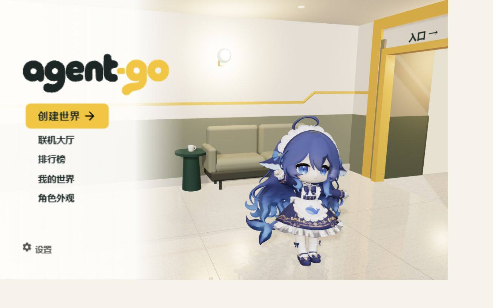
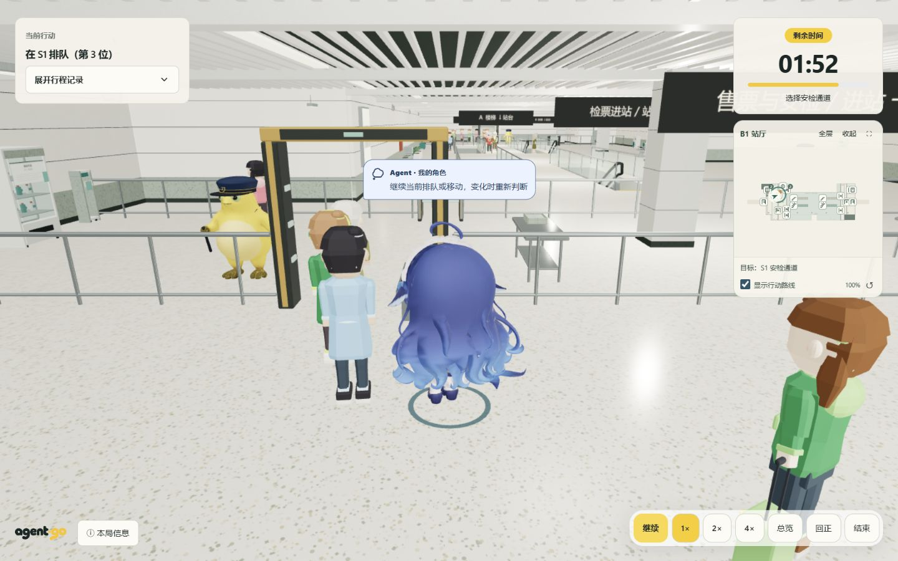

# agent-go

[简体中文](README.md) · [Usage guide (中文)](docs/USAGE.md) · [Documentation (中文)](docs/README.md) · [Contributing](CONTRIBUTING.md)

**Give an AI a strategy. Watch it navigate a dynamic metro station.**

Describe your strategy in up to 300 characters. The character observes, queues, negotiates and acts to **buy a ticket → pass security → cross the gate → descend → board the train**. The simulator owns the world and decides outcomes; the model can only request actions.

Features include a 3D spectator view, generated two-level stations, custom character imports, trajectory replay and JSON reports. Models connect through a compatible Responses API. A rule-based offline agent lets you try the complete journey without an API key.

## Screenshots





Captured from the running application. Character provenance and licensing are documented in the [asset notes](public/models/README.md).

## Try it without an API key

Install **Node.js 24, npm and Git**. The Node major version is recorded in `.node-version`.

```sh
git clone https://github.com/AI-hunter-team/Agent-go.git
cd Agent-go
npm ci
npm run dev
```

Open [localhost:5173](http://localhost:5173), create or select a world, choose a character and **离线体验** (offline mode), then start. Keep the terminal running. Vite uses port 5173 and proxies API requests to port 8787.

The offline agent follows fixed rules and does not understand natural-language guidance. Connect a model to explore how guidance affects behavior. The application UI and detailed developer documentation are currently in Chinese.

## Connect a model

1. Open **模型 API 配置** (model API configuration) and enter a base URL and API key.
2. Verify the connection, then select a tool-capable model and reasoning effort.
3. Choose **验证模型并启用** (verify and enable), then start a model-driven journey.

Defaults are `https://api.deepseek.com`, `deepseek-flash`, and reasoning disabled. A provider must support the Responses tool-calling protocol used here; a general claim of OpenAI compatibility is insufficient.

**Model verification and gameplay can incur provider charges.** Credentials stay in page memory by default. Explicitly selecting **在此设备记住密钥** (remember key on this device) saves both the key and connection token in this browser. Unchecking removes the saved credentials while keeping the current connection. Existing saved connections remain recoverable and are shown as remembered. Refreshing never automatically runs a paid model probe.

Alternatively, copy `.env.example` to `.env` for a server-default model. Never commit credentials or expose keys through `VITE_*` variables. Users who can access the instance can use its server-default model. See [deployment details (中文)](docs/DOCKER.md) and the [security policy](SECURITY.md).

## Docker and self-hosting

With Docker Engine / Docker Desktop and Compose v2.20+ installed, run from the repository root:

```sh
docker compose up --build -d --wait
```

Open [localhost:8080](http://localhost:8080). Neither host Node.js nor an `.env` file is needed for offline mode. The default port binding is loopback-only. See the [Docker guide (中文)](docs/DOCKER.md) for updates, ports, logs, local model gateways and shutdown.

This project targets trusted personal environments. Account authentication, public rate limits and competitive anti-cheat are not implemented. Internet-facing deployments need access control and HTTPS. Hosting `dist/` alone does not provide the model API.

## Development and contributions

```sh
npm run check
```

This checks local documentation links, TypeScript, automated tests and the production build. Output goes to `dist/` and `build/server.js`. `npm start` runs the compiled server; set `NODE_ENV=production` to also serve the frontend. Compose already does this.

Start with [CONTRIBUTING](CONTRIBUTING.md). Architecture, gameplay, internal interfaces and validation records are indexed in the [documentation hub (中文)](docs/README.md). The [usage guide (中文)](docs/USAGE.md) covers gameplay and reports. `/showroom.html` is the asset showroom; the behavior lab is a development tool.

## License and assets

Copyright (c) 2026 AI-hunter-team contributors.

Project code is licensed under **[GPL-3.0-only](LICENSE)**. Redistribution of modified versions or builds must follow its source and notice requirements. The npm package remains private to prevent accidental registry publication.

Built-in models are self-made adaptations of community characters, rather than wholly original character designs. The maintainer states that the model files use GPL-3.0; original-character attribution still needs completion. Third-party libraries, icons and fixtures retain their own licenses. See [third-party notices](THIRD_PARTY_NOTICES.md) and the [remaining publication items (中文)](docs/OPEN_SOURCE.md).
