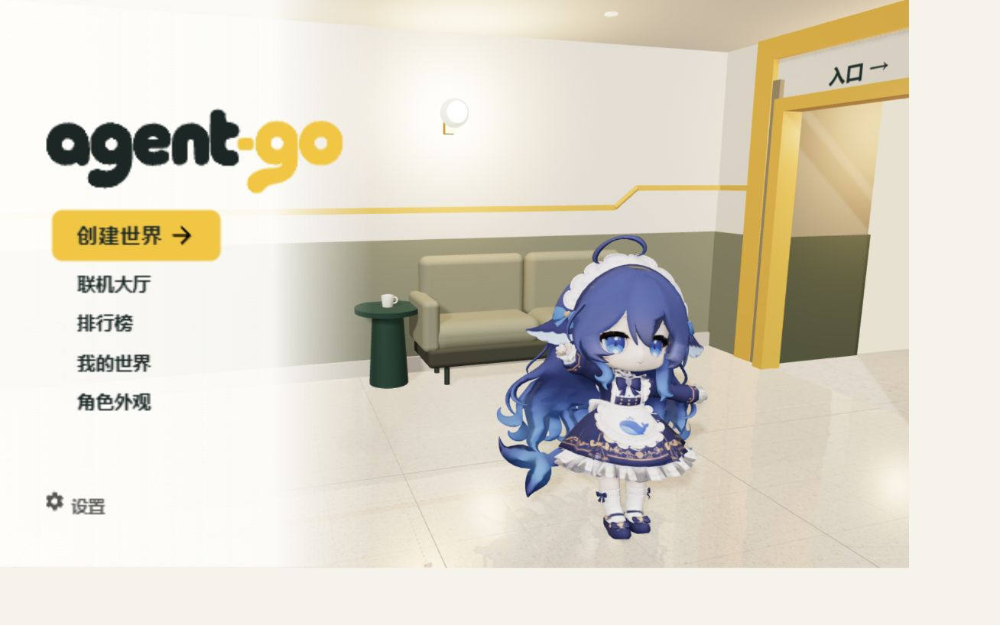
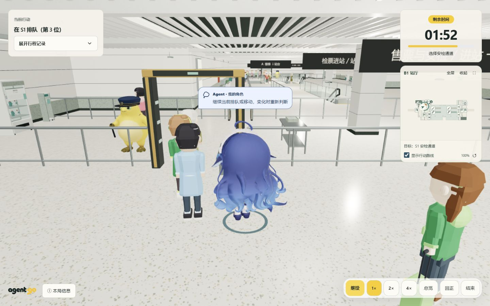

# agent-go

[English](README.en.md) · [使用指南](docs/USAGE.md) · [开发文档](docs/README.md) · [贡献](CONTRIBUTING.md)

**给 AI 一段指导，看它如何穿过一座动态地铁站。**

用最多 300 字描述你的策略，角色会自主观察、排队、沟通和行动，完成 **买票 → 安检 → 过闸 → 下楼 → 登车**。程序模拟世界并裁定结果，模型只能请求行动。

支持三维观战、生成式双层车站、角色外观导入、轨迹回放与报告导出。模型通过兼容 Responses 的接口接入；没有 API Key 也能使用离线规则 Agent 体验完整流程。

## 实际画面





截图来自本地运行版本；角色素材的来源与授权见[素材说明](public/models/README.md)。

## 无 Key 快速体验

需要 **Node.js 24、npm 和 Git**；Node 主版本由 `.node-version` 指定。

```sh
git clone https://github.com/AI-hunter-team/Agent-go.git
cd Agent-go
npm ci
npm run dev
```

打开 [localhost:5173](http://localhost:5173)，创建或选择世界，选择角色和「离线体验」，确认出发。终端需保持运行；前端默认 5173，API 默认 8787。

离线 Agent 采用固定规则，不理解自然语言指导。想观察不同指导带来的行为差异，请接入模型。

## 接入模型

1. 打开「模型 API 配置」，填写基础地址和 API Key。
2. 验证连接，选择支持工具调用的模型和思考强度。
3. 点击「验证模型并启用」，再开始模型对局。

默认基础地址为 `https://api.deepseek.com`，模型为 `deepseek-flash`，关闭思考。接口必须支持本项目使用的 Responses 工具调用；“OpenAI 兼容”并不保证所有网关都能使用。

**模型验证和对局会消耗供应商额度。** 新用户默认仅在当前页面临时使用凭据。明确勾选「在此设备记住密钥」后，密钥及连接令牌才会保存到当前浏览器；取消勾选清除保存、保留当前连接。旧版已保存的连接保持可恢复并显示保存状态。刷新不会自动发起付费验证。

也可复制 `.env.example` 为 `.env` 配置服务端默认模型。不要提交密钥或使用 `VITE_*` 保存密钥。服务端配置适用于能访问该实例的用户；详情见[部署与配置](docs/DOCKER.md)及[安全说明](SECURITY.md)。

## Docker 与自托管

安装 Docker Engine / Docker Desktop 和 Compose v2.20+ 后，在仓库根目录运行：

```sh
docker compose up --build -d --wait
```

打开 [localhost:8080](http://localhost:8080)。无需宿主机 Node.js，也无需 `.env` 即可离线体验。默认仅绑定本机；更新、端口、日志、模型网关及停止方式见[完整 Docker 教程](docs/DOCKER.md)。

本项目面向个人可信环境，尚无账号鉴权、公网限流和竞技防作弊。公网托管需要另行配置访问控制及 HTTPS。单独部署 `dist/` 不包含模型 API。

## 开发与贡献

```sh
npm run check
```

统一执行文档链接检查、类型检查、自动化测试和生产构建；构建输出为 `dist/`、`build/server.js`。`npm start` 启动编译后的 API；提供静态页面还需设置 `NODE_ENV=production`，Compose 已配置。

- [贡献指南](CONTRIBUTING.md)：问题反馈、开发流程和验证要求。
- [文档导航](docs/README.md)：玩法、架构、内部接口和实现依据。
- [使用指南](docs/USAGE.md)：详细玩法、模型设置、回放和报告。
- [路线图](docs/ROADMAP.md)与[验证记录](docs/validation/README.md)：阶段目标及已验证范围。
- `/showroom.html` 提供素材展厅；行为实验台属于开发工具，入口见使用指南。

## 许可与素材

Copyright (c) 2026 AI-hunter-team contributors。

项目代码采用 **[GPL-3.0-only](LICENSE)**。分发修改版或构建产物时，请遵守许可证中的源码和声明要求。npm 包保持 `private: true`，用于防止误发布。

内置角色是基于社区角色自行建模的二创，模型文件按维护者提供的说明采用 GPL-3.0；原角色来源与署名尚需补齐，不标为完全原创。图标、第三方库及测试素材保留各自许可，详见[第三方声明](THIRD_PARTY_NOTICES.md)和[公开前剩余事项](docs/OPEN_SOURCE.md)。
